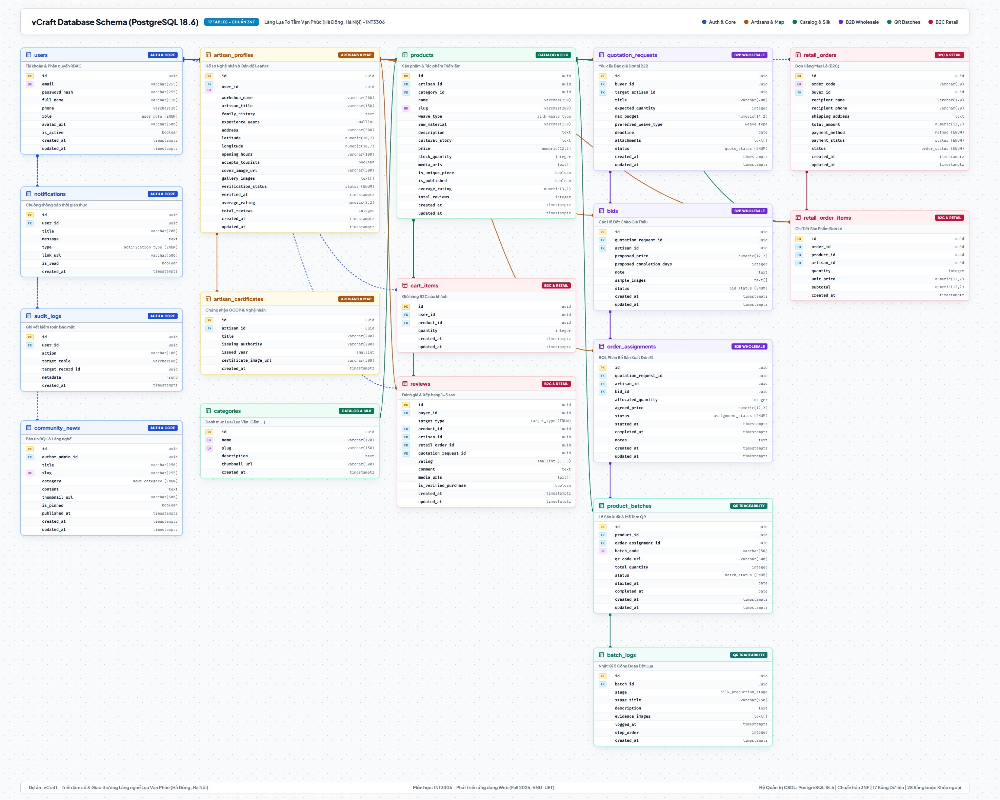

# vCraft - Nền Tảng Triển Lãm Số & Giao Thương Làng Nghề Truyền Thống

> **Học phần**: INT3306 - Phát triển ứng dụng Web (Fall 2026, VNU-UET)  
> **Bối cảnh demo** là **làng lụa Nha Xá, phường Duy Tân, tỉnh Ninh Bình**.<br>
> **Repository**: [https://github.com/BuddieBear/vCraft-Web](https://github.com/BuddieBear/vCraft-Web)  
> **Quy ước Commit**: [Conventional Commits](https://gist.github.com/qoomon/5dfcdf8eec66a051ecd85625518cfd13)

---

## 1. Giới Thiệu Tổng Quan

**vCraft** là nền tảng web được thiết kế riêng cho Ban quản lý (BQL) và các hộ gia đình nghệ nhân của một làng nghề truyền thống. Thay vì chỉ là sàn thương mại điện tử thông thường, hệ thống tập trung vào:
1. **Triển lãm số (Digital Exhibition)**: Tôn vinh câu chuyện văn hóa, tác phẩm độc bản và tiểu sử các nghệ nhân lão thành.
2. **Truy xuất nguồn gốc & Mã QR**: Theo dõi 5 công đoạn minh họa từ ươm tơ, mắc cửi, dệt, nhuộm đến cán láng. Mã QR dẫn đến trang nhật ký lô sản phẩm.
3. **Bản đồ tương tác làng nghề (Interactive Map)**: Định vị GPS các xưởng dệt, hỗ trợ du khách xem thông tin, giờ mở cửa và trạng thái đón khách trải nghiệm.
4. **Song hành 2 mô hình giao thương**:
   - **B2C (Bán lẻ)**: Giỏ hàng, đơn hàng lẻ, theo dõi giao hàng và đánh giá chất lượng sản phẩm.
   - **B2B (Mua sỉ / Đặt may lớn)**: Xử lý chu trình trạng thái đấu thầu phức tạp (*Quotation State Machine: Draft $\rightarrow$ Sent $\rightarrow$ Bidding $\rightarrow$ Buyer Accepted $\rightarrow$ In Production $\rightarrow$ Delivered*) và cơ chế phân bổ đơn hàng cho nhiều hộ dệt cùng thực hiện.

---

## 2. Kiến Trúc Cơ Sở Dữ Liệu (PostgreSQL 18 - Chuẩn Hóa 3NF)

CSDL bao gồm **17 bảng chuẩn hóa 3NF**, phân thành 5 phân hệ nghiệp vụ.



Bộ ERD và SQL tham chiếu ghi lại thiết kế ban đầu. Môi trường phát triển dùng [Prisma migrations](prisma/migrations/) và [seed Nha Xá](prisma/seed.js).

### Tài Liệu & Công Cụ CSDL Đi Kèm:
- 📊 **Sơ đồ ERD chi tiết & Ma trận bản số:** [docs/erd/erd-draft.md](docs/erd/erd-draft.md)
- 💾 **SQL tham chiếu của bản thiết kế:** [database/postgresql/relational-schema.sql](database/postgresql/relational-schema.sql)
- 🌐 **Trang Web Trực Quan Tương Tác (Zoom/Pan & Tra Cứu):** [docs/erd/visualizers/schema_visualizer.html](docs/erd/visualizers/schema_visualizer.html)
- 🗄️ **Mô hình Prisma ORM:** [prisma/schema.prisma](prisma/schema.prisma)

---

## 3. Cấu Trúc Thư Mục Dự Án

```text
vCraft/
├── backend/                   # Bộ khung REST API Node.js phân tầng
├── frontend/                  # Giao diện demo và dữ liệu mẫu
├── database/                  # Script SQL, tách theo hệ quản trị
│   ├── postgresql/            # DDL và dữ liệu mẫu cho môi trường local
│   └── mysql/                 # Script SQL cho MySQL
├── docs/
│   ├── requirements/          # Yêu cầu nghiệp vụ
│   └── erd/                   # Báo cáo, ảnh, trang HTML và công cụ tạo sơ đồ
├── prisma/                    # Cấu hình ORM Prisma cho PostgreSQL
│   └── schema.prisma          # 17 models và 14 enums
├── ARCHITECTURE.md             # Kiến trúc và quy ước thư mục
├── docker-compose.yml         # Container PostgreSQL 18, Redis 7 & pgAdmin 4
├── .env.example               # Biến môi trường mẫu
└── .gitignore                 # Cấu hình bỏ qua file nhạy cảm và cache
```


Xem [hướng dẫn chạy frontend demo](frontend/README.md) và [kiến trúc API phân tầng](ARCHITECTURE.md).

---

## 4. Khởi tạo PostgreSQL phát triển

Sao chép `.env.example` thành `.env` nếu chưa có. Tạo database trống `vcraft_nhaxa_dev` trên PostgreSQL local hoặc chạy `docker compose up -d postgres` để tạo database trong container. Kết nối Docker dùng cổng máy chủ `5433` mặc định và tài khoản quản trị ban đầu `vcraft_admin`.

Tạo hai login PostgreSQL một lần bằng tài khoản quản trị. Trong `psql`, đặt mật khẩu bằng `\password`.

```sql
CREATE ROLE vcraft_migrator LOGIN;
CREATE ROLE vcraft_app LOGIN;
\password vcraft_migrator
\password vcraft_app
```

Trên PostgreSQL cài sẵn, chạy lệnh sau từ thư mục gốc. Với Docker, dùng `-p 5433 -U vcraft_admin`.

```powershell
psql -h localhost -U postgres -d vcraft_nhaxa_dev -v target_db=vcraft_nhaxa_dev -v migration_role=vcraft_migrator -v app_role=vcraft_app -f database/postgresql/configure-roles.sql
```

Đặt `DATABASE_URL` bằng thông tin của `vcraft_app` và `MIGRATION_DATABASE_URL` bằng thông tin của `vcraft_migrator`. Hai URL trỏ về cùng database. Khi triển khai, cấp URL runtime cho tiến trình backend và cấp cả hai URL cho bước chạy migration.

Chạy các lệnh sau từ thư mục gốc.

```powershell
npm ci
npm run db:validate
npm run db:generate
npm run db:migrate
npm run db:status
psql -h localhost -U vcraft_migrator -d vcraft_nhaxa_dev -v target_db=vcraft_nhaxa_dev -v app_role=vcraft_app -f database/postgresql/grant-runtime.sql
```

Chạy lại `grant-runtime.sql` sau migration thêm bảng để cấp quyền đọc/ghi cho backend. Bảng lịch sử Prisma thuộc quyền của tài khoản migration.

Đặt `SEED_DEMO_PASSWORD` trong `.env` rồi chạy `npm run db:seed` trong môi trường phát triển. Seed dùng kết nối migration. Tài khoản mẫu gồm `admin@nhaxa.example`, `buyer@nhaxa.example` và một tài khoản cho mỗi xưởng, ví dụ `nep-van@nhaxa.example`. Seed giữ các bản ghi đã có khi chạy lại và hoàn tác toàn bộ lượt chạy nếu slug sản phẩm hoặc mã lô xung đột.

### Giá và đơn vị bán

- `FIXED` lưu giá VND dạng `Decimal`, từ 0 trở lên. Khi trả JSON, biểu diễn giá bằng chuỗi thập phân.
- `CONTACT` lưu `price = null` và hiển thị **Liên hệ**.
- `saleUnit` nhận `METER`, `PIECE`, `SET` hoặc `BOX`. Số lượng là số nguyên theo đơn vị đã chọn, kể cả mét.

### Kiểm thử ORM

Tạo database trống riêng có tên bắt đầu bằng `vcraft_orm_test_`, ví dụ `vcraft_orm_test_dev`, với quyền đủ để chạy migration. Đặt `ORM_TEST_DATABASE_URL` trỏ vào đó rồi chạy `npm run db:test`. Bộ kiểm thử chạy migration và seed trên database kiểm thử và để lại dữ liệu để kiểm tra. Mỗi lượt dùng một database trống.

## 5. Chạy API danh mục

Có thể đọc dữ liệu trực tiếp từ PostgreSQL bằng CLI. Cách này dùng cùng repository và hợp đồng JSON với API. Xem [tài liệu Persistence Layer](docs/persistence-layer.md).

```powershell
npm run --silent db:json -- hong-dat
```

Sau khi cấu hình PostgreSQL và chạy `npm run db:generate`, khởi động API từ thư mục gốc.

```powershell
npm start
```

API mặc định lắng nghe trên `127.0.0.1:5000`. Có thể cấu hình bằng `HOST` và `PORT`.

- `GET /api/products` trả `{ data, pagination }`. Tham số tùy chọn gồm `page` (mặc định 1, tối đa 10000), `limit` (mặc định 24, tối đa 100) và `category` (slug danh mục). `pagination` gồm `page`, `limit` và `hasNext`.
- `GET /api/products/:slug` trả `{ data }` cho chi tiết sản phẩm, hoặc HTTP 404 nếu sản phẩm không có trong danh mục công khai.
- Cả hai API chỉ lấy sản phẩm đã công bố của xưởng được duyệt và có tài khoản đang hoạt động. JSON chứa danh mục và thông tin công khai của xưởng. Giá là chuỗi thập phân hoặc `null` khi cần liên hệ. Chi tiết có ngày giờ ISO 8601.

```powershell
curl.exe "http://127.0.0.1:5000/api/products?category=vai-to-tam&limit=2"
curl.exe "http://127.0.0.1:5000/api/products/hong-dat"
```
