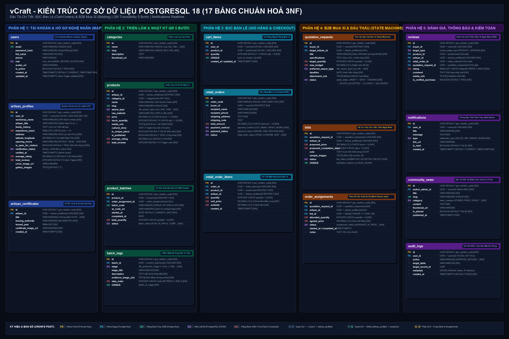

# vCraft - Nền Tảng Triển Lãm Số & Giao Thương Làng Nghề Truyền Thống

> **Học phần**: INT3306 - Phát triển ứng dụng Web (Fall 2026, VNU-UET)  
> **Làng nghề nghiên cứu**: **Làng lụa tơ tằm Vạn Phúc (Hà Đông, Hà Nội)**  
> **Repository**: [https://github.com/BuddieBear/vCraft-Web](https://github.com/BuddieBear/vCraft-Web)  
> **Quy ước Commit**: [Conventional Commits](https://gist.github.com/qoomon/5dfcdf8eec66a051ecd85625518cfd13)

---

## 1. Giới Thiệu Tổng Quan

**vCraft** là nền tảng web được thiết kế riêng cho Ban quản lý (BQL) và các hộ gia đình nghệ nhân của một làng nghề truyền thống. Thay vì chỉ là sàn thương mại điện tử thông thường, hệ thống tập trung vào:
1. **Triển lãm số (Digital Exhibition)**: Tôn vinh câu chuyện văn hóa, tác phẩm độc bản và tiểu sử các nghệ nhân lão thành.
2. **Truy xuất nguồn gốc & Mã QR**: Lưu trữ vòng đời 5 công đoạn dệt lụa Vạn Phúc (*Ươm tơ $\rightarrow$ Mắc cửi $\rightarrow$ Dệt $\rightarrow$ Nhuộm $\rightarrow$ Cán láng*), tự động tạo mã QR quét ra trang Landing Page kể lại toàn bộ câu chuyện lô sản phẩm.
3. **Bản đồ tương tác làng nghề (Interactive Map)**: Định vị GPS các xưởng dệt, hỗ trợ du khách xem thông tin, giờ mở cửa và trạng thái đón khách trải nghiệm.
4. **Song hành 2 mô hình giao thương**:
   - **B2C (Bán lẻ)**: Giỏ hàng, đơn hàng lẻ, theo dõi giao hàng và đánh giá chất lượng sản phẩm.
   - **B2B (Mua sỉ / Đặt may lớn)**: Xử lý chu trình trạng thái đấu thầu phức tạp (*Quotation State Machine: Draft $\rightarrow$ Sent $\rightarrow$ Bidding $\rightarrow$ Buyer Accepted $\rightarrow$ In Production $\rightarrow$ Delivered*) và cơ chế phân bổ đơn hàng cho nhiều hộ dệt cùng thực hiện.

---

## 2. Kiến Trúc Cơ Sở Dữ Liệu (PostgreSQL 18 - Chuẩn Hóa 3NF)

CSDL bao gồm **17 bảng chuẩn hóa 3NF**, phân thành 5 phân hệ nghiệp vụ:



### Tài Liệu & Công Cụ CSDL Đi Kèm:
- 📊 **Sơ đồ ERD chi tiết & Ma trận bản số:** [docs/erd-draft.md](docs/erd-draft.md)
- 💾 **Script DDL & Seed Data PostgreSQL 18:** [docs/relational-schema.sql](docs/relational-schema.sql)
- 🌐 **Trang Web Trực Quan Tương Tác (Zoom/Pan & Tra Cứu):** [docs/schema_visualizer.html](docs/schema_visualizer.html)
- 🗄️ **Mô hình Prisma ORM:** [prisma/schema.prisma](prisma/schema.prisma)

---

## 3. Cấu Trúc Thư Mục Dự Án

```text
vCraft/
├── docs/                      # Tài liệu phân tích, ERD, DDL SQL & Seed data
│   ├── erd-draft.md           # Báo cáo chi tiết ERD & lý thuyết chuẩn hóa 3NF
│   ├── relational-schema.sql  # Script DDL 17 bảng PostgreSQL + Seed data thực tế
│   ├── schema_visualizer.html # Web visualizer tương tác phóng to/thu nhỏ
│   └── vcraft_schema.png      # Ảnh sơ đồ ERD chuẩn quốc tế Crow's Foot (3031 x 3190 px)
├── prisma/                    # Cấu hình ORM Prisma cho PostgreSQL
│   └── schema.prisma          # 17 models và 14 enums
├── frontend/                  # Mã nguồn giao diện người dùng
├── docker-compose.yml         # Container PostgreSQL 15, Redis 7 & pgAdmin 4
├── .env.example               # Biến môi trường mẫu
└── .gitignore                 # Cấu hình bỏ qua file nhạy cảm và cache
```

---

## 4. Hướng Dẫn Khởi Chạy Cơ Sở Dữ Liệu Local

### Cách 1: Sử dụng Docker Compose
```bash
docker-compose up -d
```

### Cách 2: Sử dụng PostgreSQL cài đặt sẵn trên máy
1. Tạo database: `CREATE DATABASE vcraft_db;`
2. Chạy file DDL:
   ```bash
   psql -U postgres -d vcraft_db -f docs/relational-schema.sql
   ```
3. Xem đồ thị quan hệ trực quan: Mở pgAdmin 4 $\rightarrow$ Chuột phải `vcraft_db` $\rightarrow$ **Generate ERD**.
