# Biểu đồ tuần tự vCraft

Bộ biểu đồ mô tả các luồng dự kiến cho khách tham quan, người mua, nghệ nhân và Ban quản lý (BQL). Thiết kế dựa trên [yêu cầu nghiệp vụ](../requirements/gdoc_requirements.txt), [kiến trúc phân tầng](../../ARCHITECTURE.md), [schema Prisma](../../prisma/schema.prisma) và [DDL PostgreSQL](../../database/postgresql/relational-schema.sql).

Trong mỗi sơ đồ, **Route + MW** là tuyến HTTP và middleware. Mũi tên liền biểu thị yêu cầu, mũi tên đứt biểu thị kết quả trả về. Cơ chế phiên đăng nhập và cách đẩy thông báo sẽ được chốt khi triển khai. Các ví dụ B2C dùng COD. Trong luồng B2B, khách chọn một hoặc nhiều chào giá, BQL phân đủ số lượng yêu cầu cho các chào giá được chọn và hệ thống xác nhận đã giao khi mọi phần việc hoàn tất.

## 1. Đăng nhập và xác định vai trò

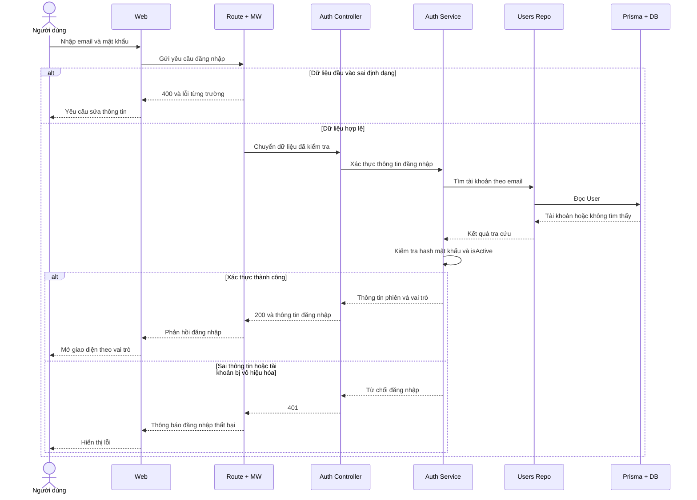

## 2. Khám phá triển lãm và bản đồ làng nghề

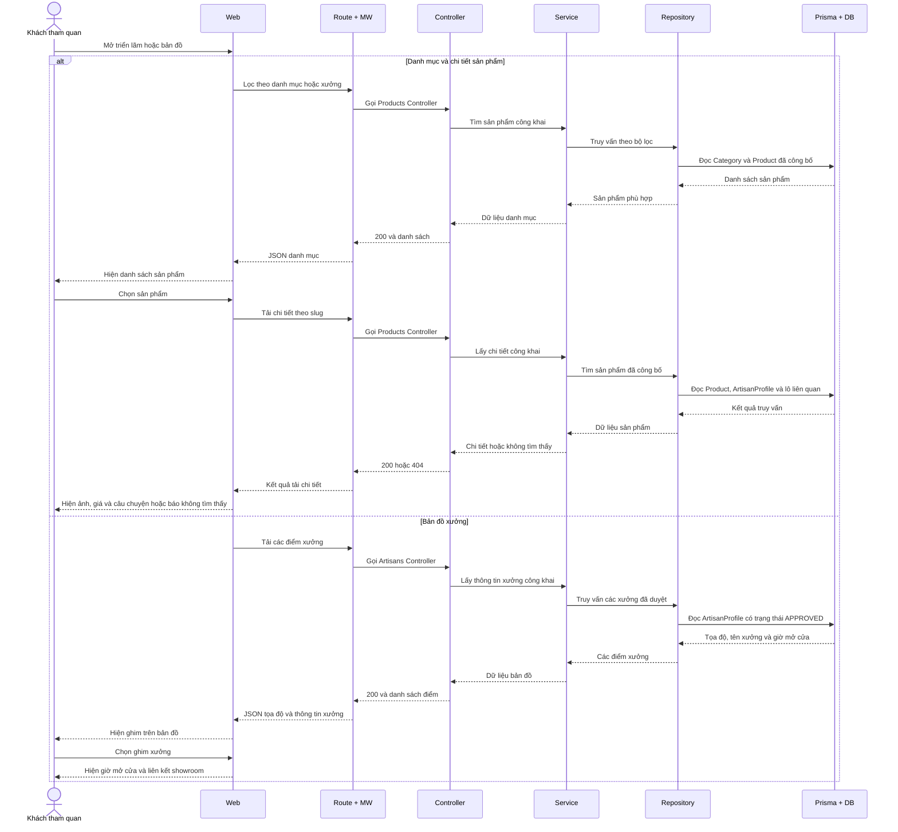

## 3. Ban quản lý duyệt hồ sơ nghệ nhân

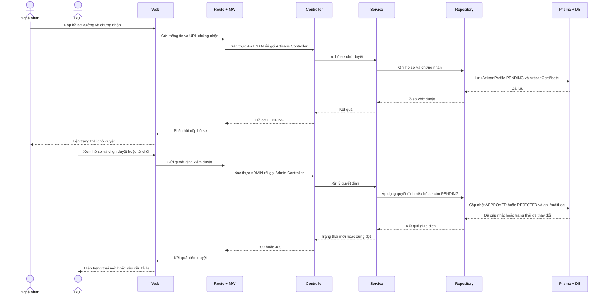

## 4. Ghi nhật ký và quét QR theo lô

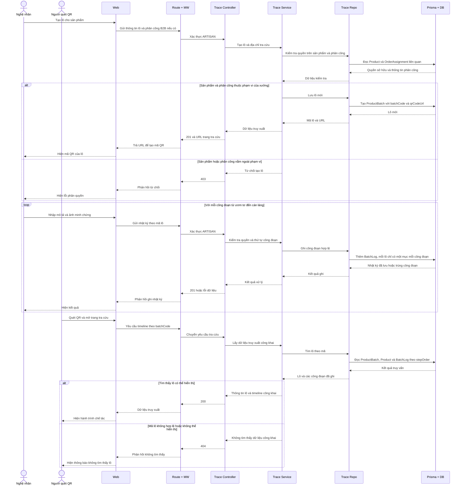

## 5. Thêm vào giỏ và đặt đơn bán lẻ B2C

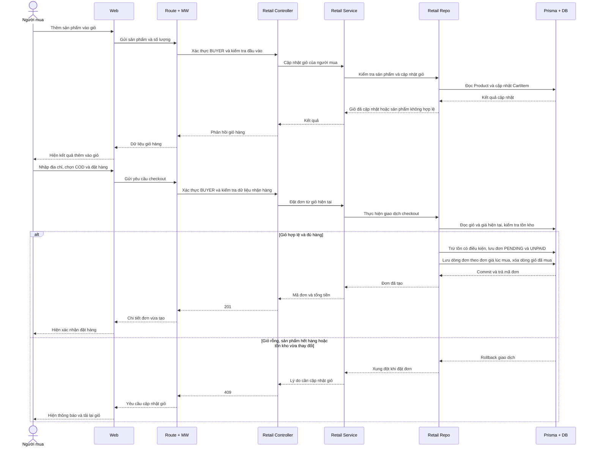

## 6. Cập nhật và theo dõi đơn bán lẻ

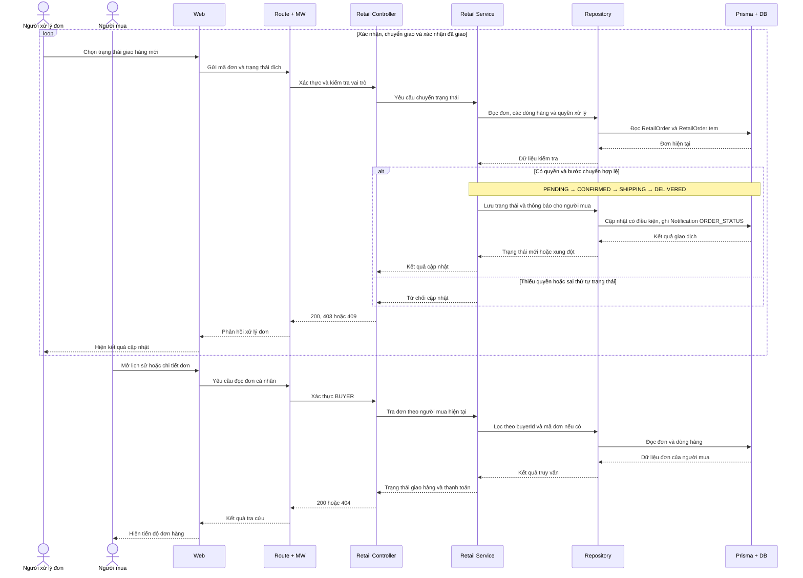

## 7. Gửi yêu cầu báo giá và nhận chào giá B2B

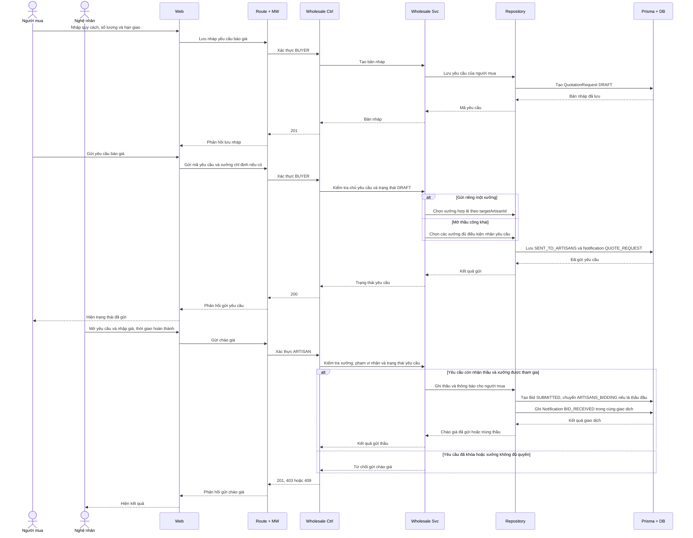

## 8. Chốt thầu và phân công sản xuất B2B

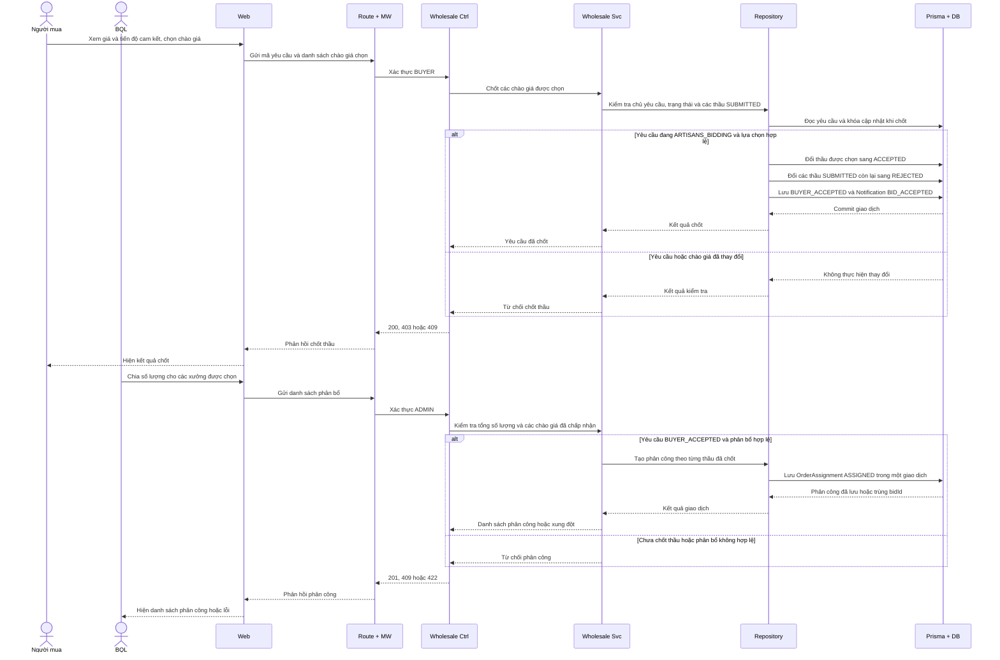

## 9. Theo dõi sản xuất và giao đơn sỉ

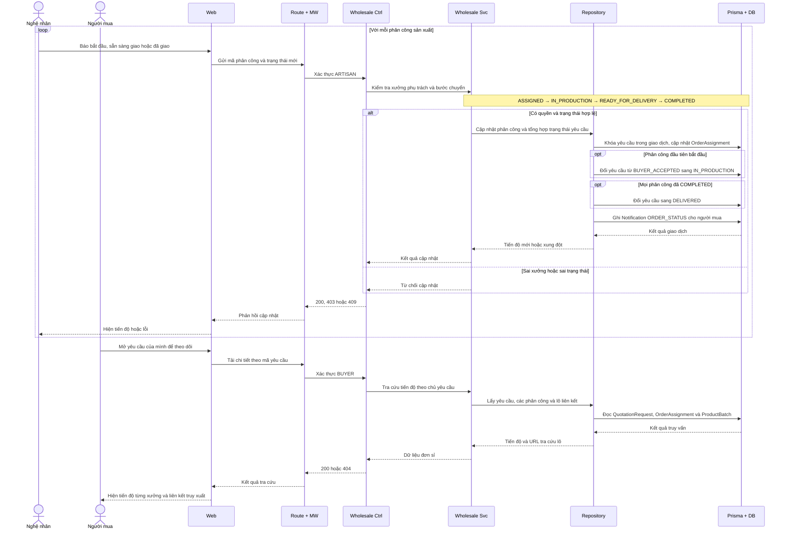

## 10. Đánh giá sau khi mua hàng

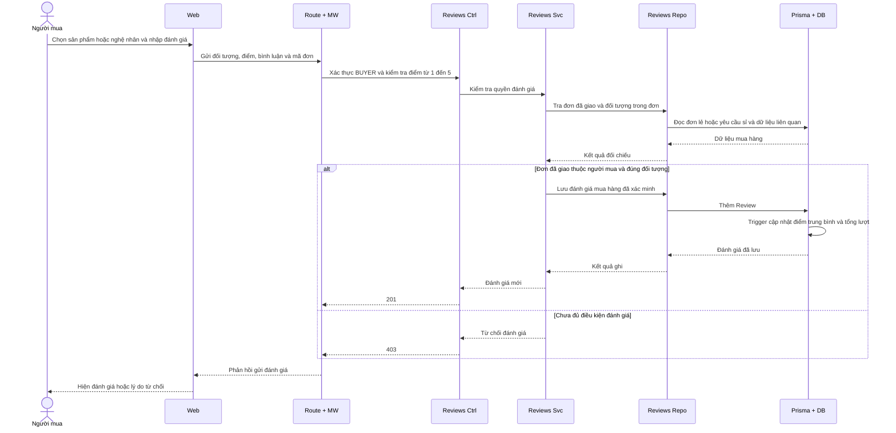

## 11. Đăng tin cộng đồng và xem thông báo

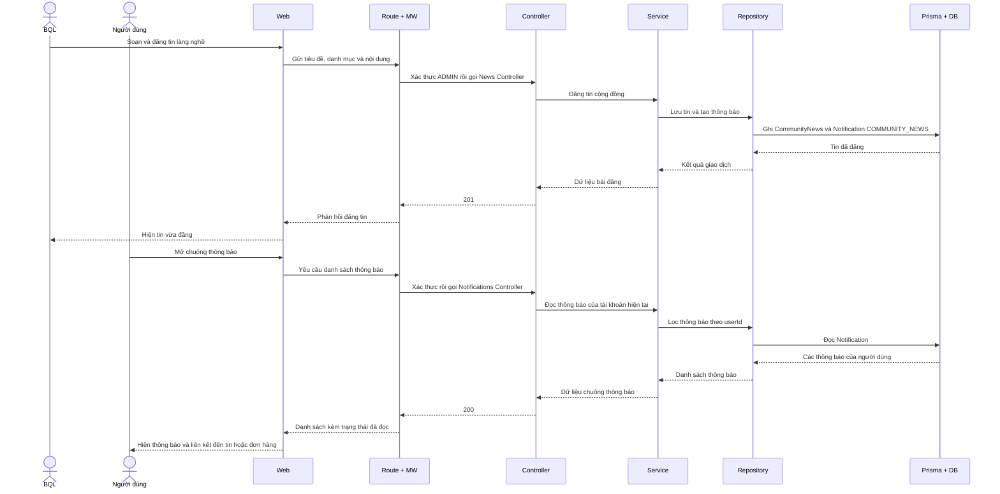
